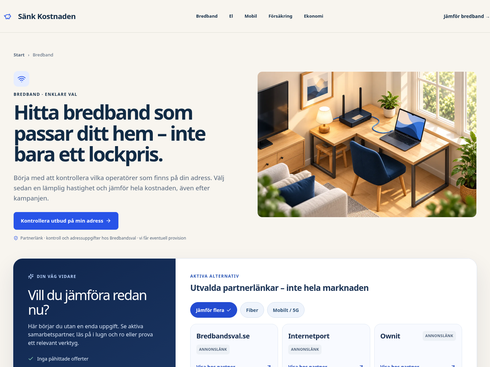
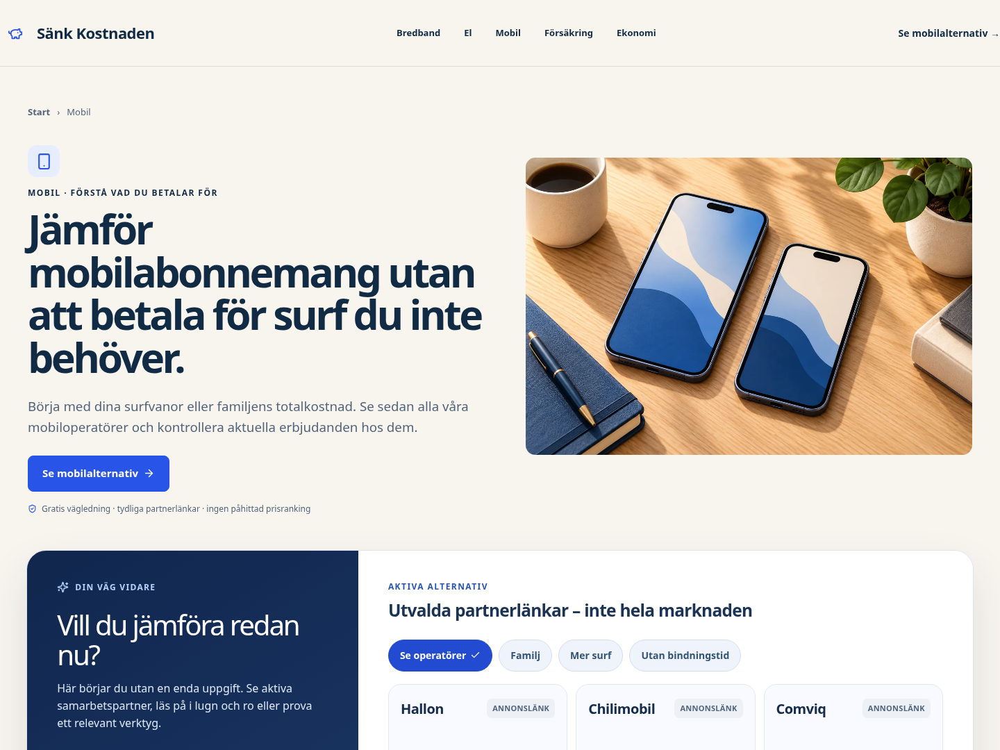
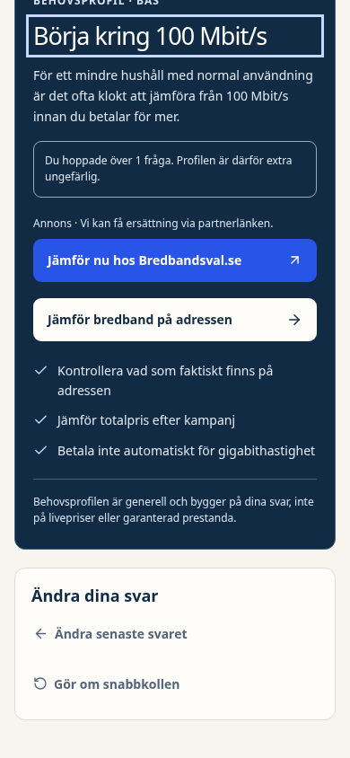
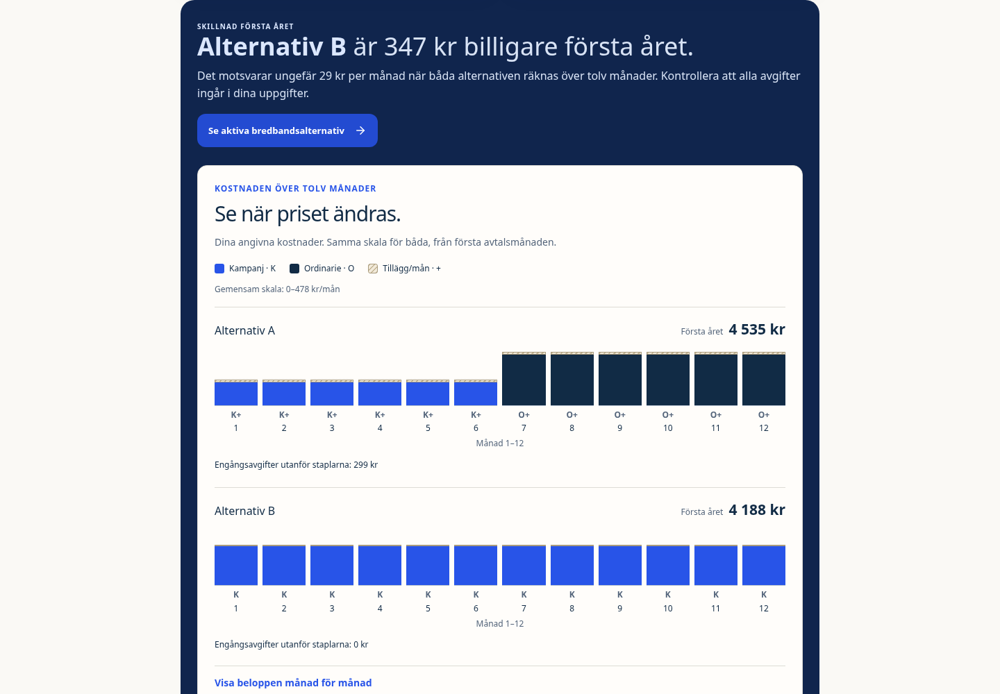

# Bildsystem 03 – faktisk rendering, 15 oktober

Ägarens godkända bildriktning är implementerad med fem egna kategorimotiv, en tydlig behovsprofil på mobil och ett kostnadsdiagram byggt från besökarens inmatning. Här visas riktiga Chromium-renderingar från den testade exporten vid 390 och1440px.

Kalkylbilden använder avsiktliga QA-inmatningar för Alternativ A/B. De är inte aktuella partnerpriser. Partnerutgångar har inte klickats. Bilderna är lokal visuell evidens; skarp leverans ska verifieras separat i CI. Fysisk iPhone och intäktslyft är inte uppmätta.

## Bredband – egen miljö och läsbar första handling

## Mobil – samma visuella värld, ett eget motiv

## Behovsprofil på mobil – svaret och märkt partnerhandling först

## Förstaårskostnad – samma skala och separat engångsavgift

[Beslut, avgränsning och faktiska kontroller](../../decisions/2026-10-15-category-artwork.md). [Kommersiell Chromium/WebKit-regression](https://github.com/arvidlandin-cpu/sankkostnaden/actions/runs/38705503721). [Läsande SEO-/assetkontroll](https://github.com/arvidlandin-cpu/sankkostnaden/actions/runs/38705503753).
