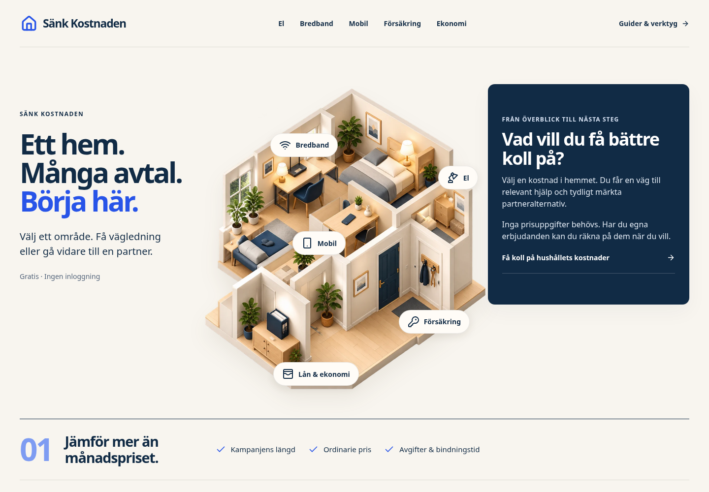
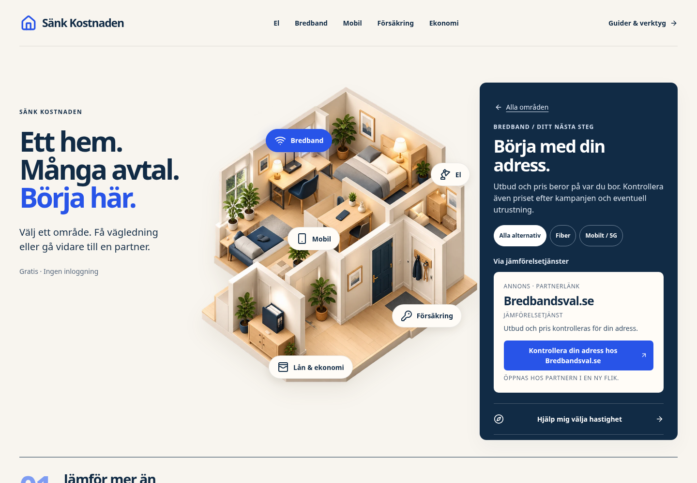
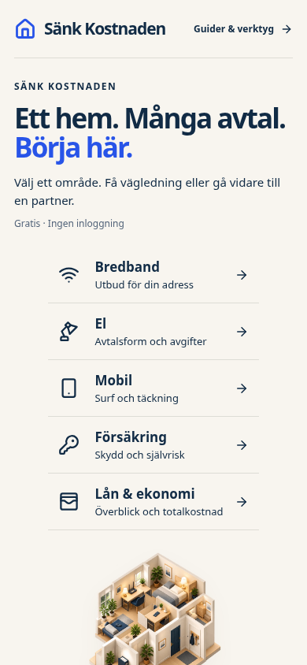
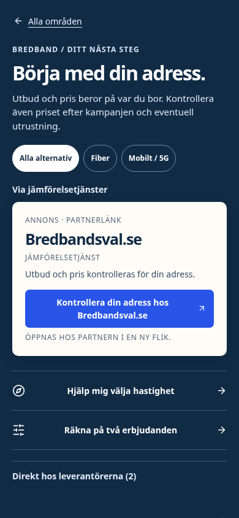

# Kostnadskartan — byggd version av förslag 03

Riktiga skärmbilder av den fungerande webbplatsen, tagna 14 oktober 2026 i Chromium från det lokala produktionsbygget. Bilderna är inte designmockuper. De visar första skärmen vid 1440 respektive 390 pixlars bredd.

Fem kostnadsområden leder till relevanta, annonsmärkta partners och befintliga guider och verktyg. Mobilen visar de fem valen först och flyttar sedan fokus till nästa steg. Samma illustration och färger följer med till kategorierna och behovsguiderna.

## Dator: välj ett område

## Dator: bredband valt

## Mobil: alla fem val direkt

## Mobil: nästa steg efter ett val

Skärmbilder visar utseende, inte uppmätt trafik eller intäkt. [Beslut och verifieringsstatus](../../decisions/2026-10-14-cost-map-implementation.md) skiljer QA, GitHub, publicering och verkliga affärsresultat åt. Produktionssättning och fysisk iPhone-testning ska verifieras separat.
