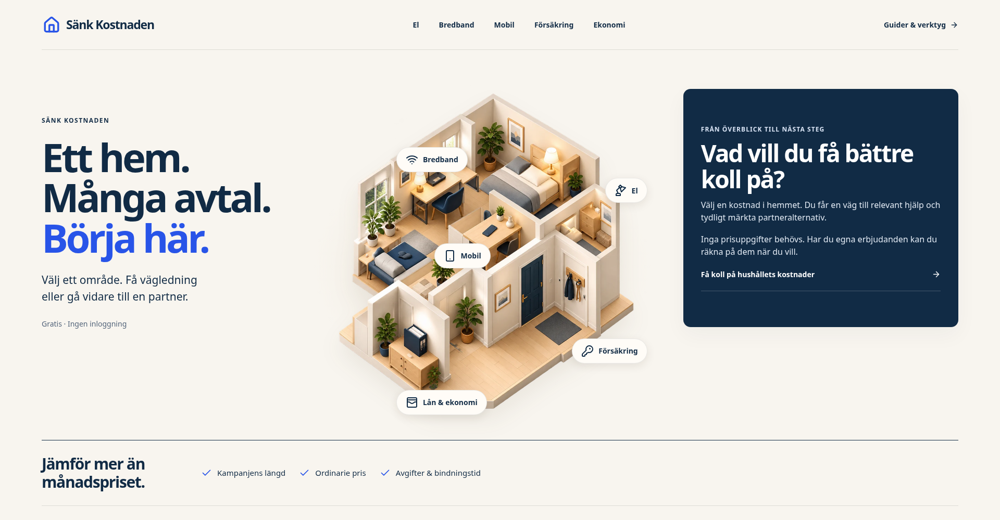
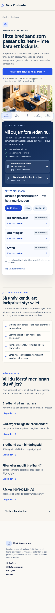
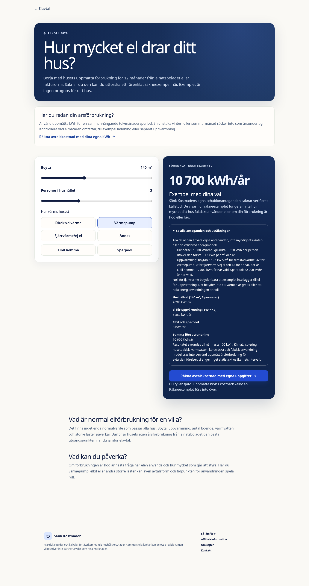

# Färdiga användarresor inom koncept 03

Riktiga Chromium-skärmbilder från gemensamt statiskt produktionsbygge 15 oktober 2026. Detta är fungerande sidor, inte genererade skisser. QA använder inga riktiga annonsutgångar. Exempel och inmatade priser visar verktygens funktion, inte erbjudanden från en partner.

## Startsidan vid 1920px

Huset och de fem valen finns kvar. Kartan ryms tillsammans med hela jämförelsebandet inom en 1000px hög vy.

## Bredband på mobil

En gemensam första beslutsyta med samtliga tre aktiva bredbandspartners. Teknikguiden och båda gamla ankarlänkarna finns kvar.

## Kalkylen öppnar vid prisfälten

En explicit länk till förstaårskalkylen visar båda fälten direkt, även före JavaScript. Vägen till partneralternativ är frivillig.

## Husets el: synliga antaganden

Uppmätt tolvmånadershistorik rekommenderas först. Det egna förenklade räkneexemplet visar alla antaganden och delsummor, utan obelagt myndighetsstöd eller personlig låg/högklassning.

Försäkringens hjälp följer också varje valt ändamål. Guidefakta kommer före nästa beslut. Kvartsprisets skyddade innehåll har jämförts byte för byte och är oförändrat. Funktionell QA och en granskad bild är inte belägg för ökad trafik eller provision; skarp releaseidentitet följs separat i GitHub Actions.
