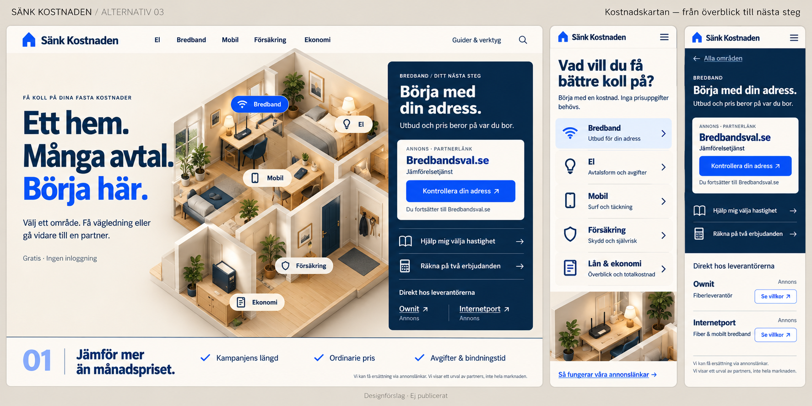
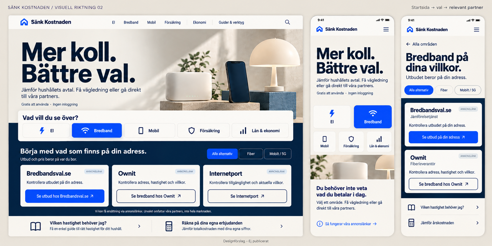

# Alternativ 03 – Kostnadskartan

Ett visuellt alternativ till förslag 02. Fyra agenter har bidragit med design, produktresa, partnerpresentation och internationella referensprinciper.

## Det nya spåret

En egen illustrerad kostnadskarta på datorn och en fokuserad handlingspanel bredvid. På mobilen står fem begripliga kategorival först. Guider och frivilliga beräkningar följer samma struktur som de tydligt annonsmärkta partnerutgångarna.

Datorbilden visar Bredband valt; mobilbilderna visar före och efter kategorivalet. Hemmets fem textetiketter är tänkta att fungera som kategorival.

Detta är en genererad konceptbild för granskning, inte en fungerande implementation. Klickflöden och partnerplacering återstår att validera. Detaljcopy och beteenden ska verifieras i riktig kod. Aktuella internationella referenssidor kunde inte granskas i denna omgång; inspirationsprinciper och avgränsningar finns i [underlaget](UNDERLAG.md).

## Jämför med förslag 02

Förslag 02 är mer direkt jämförelseinriktat. Alternativ 03 ger en mer utforskande, egen visuell identitet. Ingen av bilderna bevisar effekt på trafik eller provision. Båda bevaras för ägargranskning och produktionssajten ändras inte.
